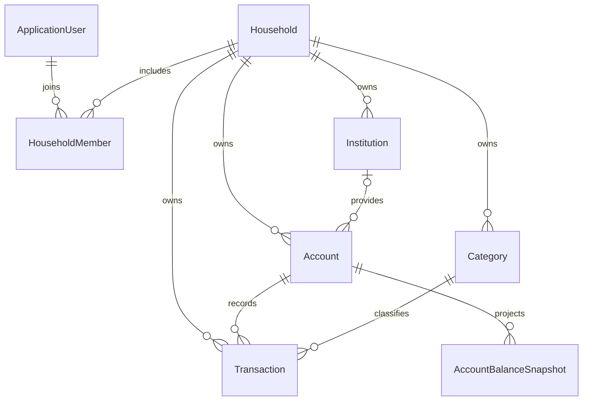

# Domain Blueprint

[Documentation index](../README.md#documentation)

This blueprint describes the implemented model. Planned concepts are listed
separately below. EF models live in `Coiny.API/Models/` and are registered through
`CoinyContext`; Identity contributes its own user and role tables.

## Implemented entities

| Entity | Purpose and relationships |
| --- | --- |
| `ApplicationUser` | Identity user with email and nullable `FirstName`; linked to households through memberships |
| `Household` | Shared financial space with memberships, institutions, accounts, categories, and transactions |
| `HouseholdMember` | Links a user to a household with an `Owner` or `Member` role |
| `Institution` | Household-owned bank/provider; has accounts |
| `Account` | Household-owned account, optional institution, opening balance/date, transactions, and snapshots |
| `Category` | Household-owned transaction classification with `Income`, `Expense`, or `Transfer` type |
| `Transaction` | Required household, account, and category; positive amount, date, description, optional merchant/notes, cleared flag |
| `AccountBalanceSnapshot` | Account's derived closing balance on one calendar day |

Domain entities inherit integer `Id` and UTC `CreatedAt` from `BaseEntity`.
`ApplicationUser` inherits Identity's string ID instead.

## Ownership and membership

Services resolve the authenticated user's household from their membership.
Account/institution selection and transaction account/category references are
checked against it. No household ID is accepted in financial creation payloads.

Household creation rejects users who already have a membership. The database
uniquely indexes `(HouseholdId, UserId)`, while the service currently selects the
first membership for a user. Household switching, invitations, and role-based
financial permissions are not implemented.

## Accounts and balances

`AccountType` values are `Checking`, `Savings`, `CreditCard`, `Investment`,
`Retirement`, `Loan`, `Cash`, `Crypto`, and `Other`. Credit cards and loans are
liabilities; the other types are treated as assets by current calculations.

`OpeningBalanceDate` is a `DateOnly`. The opening balance is the balance at the
start of that date. Current balance is derived, not an editable stored total.
See [financial rules](03-account-trends.md) for debt signs and historical behavior.

`IsActive` flags exist on accounts, institutions, and categories. There are no
activation-management endpoints, and account listing/dashboard totals do not
currently filter inactive accounts.

## Constraints and current model boundaries

- Snapshots uniquely index `(AccountId, SnapshotDate)`.
- Categories uniquely index `(HouseholdId, Name)`; the creation service also
  checks duplicate names case-insensitively.
- Account and transaction monetary columns are mapped as `decimal(18,2)`.
  Application-level cent rounding/scale enforcement is not implemented.
- Transactions require a category. Account/category deletion is restricted while
  transactions reference them; snapshots also restrict account deletion.
- An account can have no institution. Its configured institution relationship uses
  `SetNull` on deletion. There is no public deletion endpoint yet.
- Transactions do not currently store a creator-user audit reference.
- Categories do not currently have parent/child relationships.

## Planned concepts

| Concept | Intended purpose |
| --- | --- |
| Budget | Planned category spending over a period |
| Goal | Savings target, debt payoff, or other financial objective |
| Recurring transaction | Scheduled income or expense pattern |
| Paired transfer | Atomic movement between accounts, including card payments |
| Category hierarchy | Parent/child classifications |
| Transaction audit | Attribution and designed correction history |

These are design directions, not existing entities or API capabilities.
