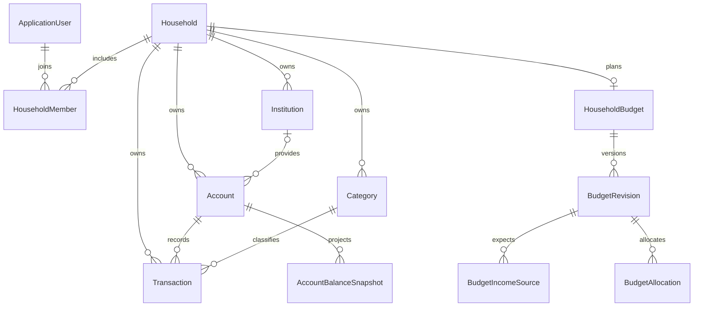

# Domain Blueprint

[Documentation index](../README.md#documentation)

This blueprint describes the implemented model. Planned concepts are listed
separately below. EF models live in `Coiny.API/Models/` and are registered through
`CoinyContext` in default legacy mode. In opt-in hybrid mode, `ControlContext`
stores Identity, households/membership and orchestration in PostgreSQL;
`HouseholdContext` stores finance in one SQLite file per household. Services use
`IControlContext` / `IFinancialContext`. Identity contributes its own user/role
tables; cross-store references use IDs and explicit ownership checks rather than
cross-database foreign keys. See [storage architecture](21-hybrid-storage-and-azure.md).

## Implemented entities

| Entity | Purpose and relationships |
| --- | --- |
| `ApplicationUser` | Identity user with email and nullable `FirstName`; linked to households through memberships |
| `Household` | Shared financial space with memberships, institutions, accounts, categories, and transactions |
| `HouseholdMember` | Links a user to a household with an `Owner` or `Member` role |
| `Institution` | Household-owned bank/provider; has accounts |
| `Account` | Household-owned account, optional institution, opening balance/date, transactions, and snapshots |
| `Category` | Household-owned transaction classification with `Income`, `Expense`, or `Transfer` type |
| `Transaction` | Required household, account, and category; positive amount, date, description, optional merchant/notes, cleared flag; transfers add In/Out direction, Unknown/External/Linked counterparty, and optional unique paired-entry reference |
| `AccountBalanceSnapshot` | Account's derived closing balance on one calendar day |
| `TransactionImportBatch` | Household/account-owned import metadata, submission ID/payload hash, actor, count, and resulting balance; transactions retain batch and source-row IDs |
| `HouseholdBudget` | One household-owned budget plan, with draft/published revisions |
| `BudgetRevision` | Complete version of income and allocations, effective month, publication state, saved wizard step |
| `BudgetIncomeSource` | Expected take-home amount per occurrence and required owned schedule |
| `BudgetAllocation` | Planned use of income with monthly amount or per-occurrence amount plus optional schedule |

Additional implemented entities:

| Entity | Purpose |
| --- | --- |
| `AuthSession`, `AuthRecoveryCode` | Revocable login sessions and hashed offline recovery codes |
| `HouseholdInvitation` | Expiring, single-use hashed join code |
| `AccountReconciliation` | Statement checkpoint with preserved review/invalidation history |
| `BillPayment`, `BillPaymentTransaction` | Paid/skipped occurrence state and additional transaction links |
| `BudgetCategoryRule`, `TransactionBudgetAssignment` | Effective category defaults and individual actuals assignments |
| `TransactionImportSession`, `TransactionImportUndo` | Atomic multi-file import receipts and reviewed undo audit |
| `MerchantCategoryRule`, `SavedCsvMapping` | Reviewable category suggestions and saved bank column layouts |
| `HouseholdRecurringSetting`, `RecurringExpenseReview` | Daily detection preference and reviewed recurring patterns |
| `HouseholdAlert`, `HouseholdAlertRead` | Shared alerts with per-user read state |
| `SavingsFund`, `SavingsActivity` | Account purpose/component plans and allocation/contribution/spending activity |

Hybrid-only operational metadata also tracks household registry/file identity,
legacy import progress, maintenance admission, and resumable preference changes.
`StorageModelOwnership` is the explicit domain ownership inventory; provider
migration snapshots define the complete physical schema.

Most financial/domain rows inherit integer `Id` and UTC `CreatedAt` from
`BaseEntity`. `ApplicationUser` inherits Identity's string ID; `AuthSession` uses a
string session ID and `AuthRecoveryCode` uses a GUID. Operational types have their
own keys; consult the provider model snapshots for exact types.
`BudgetSchedule` is an owned value with frequency, date bounds, and monthly day
numbers; it has no independent table or public ID. Budget services implement
recurrence, draft/publication, monthly and income-period projections, dated item
changes, and authenticated API workflows. Savings component plans are stored in
`SavingsFund.PlanJson`, not as independent goal rows. See [household budgeting](09-household-budgeting.md).

## Ownership and membership

Services resolve the authenticated user's household from their membership.
Account/institution selection and transaction account/category references are
checked against it. No household ID is accepted in financial creation payloads.

Household creation rejects users who already have a membership. The database
uniquely indexes UserId (one household per user), plus `(HouseholdId, UserId)`.
Owners can generate short-lived, single-use invitation codes; redemption adds a
Member atomically. Owners can remove regular members without deleting their
logins or household data; the same transaction revokes active invitations.
Owners cannot be removed. Household switching/leaving and role-based financial editing
permissions are not implemented. See [household setup](04-user-profile.md#household-creation-and-joining).

## Accounts and balances

`AccountType` values are `Checking`, `Savings`, `CreditCard`, `Investment`,
`Retirement`, `Loan`, `Cash`, `Crypto`, and `Other`. Credit cards and loans are
liabilities; the other types are treated as assets by current calculations.

`OpeningBalanceDate` is a `DateOnly`. The opening balance is the balance at the
start of that date. Current balance is derived, not an editable stored total.
See [financial rules](03-account-trends.md) for debt signs and historical behavior.

`IsActive` flags exist on accounts, institutions, and categories. Category management supports archive/restore through its update endpoint.
Account/institution activation management is not exposed, and account listing/
dashboard totals do not currently filter inactive accounts.

## Constraints and current model boundaries

- Snapshots uniquely index `(AccountId, SnapshotDate)`.
- Categories uniquely index `(HouseholdId, Name)`; the creation service also
  checks duplicate names case-insensitively.
- Account and transaction monetary columns are mapped as `decimal(18,2)`.
  Public financial-write workflows validate monetary scale and/or round derived
  allocations to cents; legacy migration compares decimal values without changing
  their meaning. Consult each workflow for its validation rules.
- Transactions require a category. Account/category deletion is restricted while
  transactions reference them; snapshots also restrict account deletion.
- An account can have no institution. Its configured institution relationship uses
  `SetNull` on deletion. There is no public deletion endpoint yet.
- Transactions do not currently store a creator-user audit reference.
- Categories do not currently have parent/child relationships.

## Later refinements

Budget workflows, savings component goals, recurring detection, and reviewed import
undo are implemented. Debt-payoff planning, category hierarchies, and a universal
creator/change audit across every manual transaction remain later refinements.
Separate household files do not provide client-side encryption or zero-knowledge
privacy.

Loan accounts have a nullable `LoanSubtype` (Mortgage, Auto, Personal, Student,
Other); non-loans have no subtype. Existing loans default to Other and require
explicit classification. `ApplicationUser.IncludeMortgageInNetWorth` defaults to
true and affects personal net-worth aggregation, not the shared ledger. Dashboard
Other Debt and Mortgage are disjoint totals. Mortgage inclusion is applied to
both current net worth and historical chart calculations.
