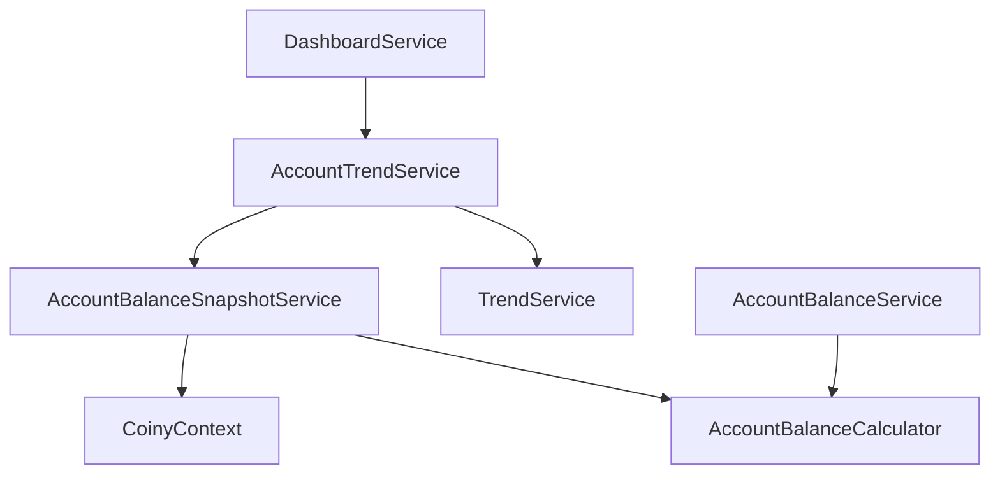

# Account Balances, Snapshots, and Trends

[Documentation index](../README.md#documentation)

## Financial rules

An account's opening balance is its balance at the **start** of
`OpeningBalanceDate`. Transactions on that date count toward its closing balance;
transactions before it are rejected. Creation currently requires a nonnegative
opening balance and a valid opening date.

Transaction amounts are positive. Category type determines their effect:

| Account kind | Income-category transaction | Expense-category transaction |
| --- | --- | --- |
| Asset | Increases balance | Decreases balance |
| Credit card or loan | Reduces balance owed | Increases balance owed |

Liability balances represent positive amounts owed. Net worth subtracts them
from assets. Liquid funds sum checking, savings, and cash; retirement sums
retirement accounts; debt sums credit cards and loans.

`Transfer` exists as a category type, but creating transfer transactions is
rejected until paired transfers are implemented. An income-category credit on a
liability is not a complete model of a checking-to-card payment.

`IsCleared` is recorded but does not exclude a transaction from balance or trend
calculations. The current app has no currency-selection or conversion model;
the frontend displays USD.

## Snapshot lifecycle

`AccountBalanceSnapshot` stores one derived closing balance per account/date.
The `(AccountId, SnapshotDate)` index is unique.

1. Account creation saves an opening-day snapshot.
2. Transaction creation saves the ledger entry, stages a recalculated closing
   balance for that date, and updates later stored snapshots.
3. The ledger/account change and snapshot writes commit in one database
   transaction. A failure rolls them back together.
4. Days without activity need no rows. Trend reads carry the last known balance
   forward to fill the daily series.

Example: a $1,000 opening balance on October 1 and a $100 expense on October 3
produce a $900 closing snapshot. Adding a $50 expense dated October 2 creates a
$950 snapshot and updates October 3 to $850.

Today’s closing snapshot is provisional: more transactions dated today update it.
Backdated transaction creation is supported; public edit/delete workflows are not.

## Service responsibilities

| Service | Responsibility |
| --- | --- |
| `AccountBalanceCalculator` | Shared asset/liability transaction effects |
| `AccountBalanceService` | Current balance from opening balance and ledger |
| `AccountBalanceSnapshotService` | Ownership checks, staged closing-balance writes, sparse history reads |
| `AccountTrendService` | Account selection, daily carry-forward, aggregation, historical date limits |
| `TrendService` | Generic change, percentage, and direction calculations |
| `DashboardService` | Dashboard totals, per-account monthly summaries, recent activity, net-worth trend requests |

Snapshot writes require an active database transaction. The caller first saves
pending ledger entries, calls `RecalculateFromAsync`, then saves snapshots and
commits. History reads include the last snapshot **before** the requested range
plus snapshots inside the inclusive range.

## Account trend selection

`IAccountTrendService.GetTrendAsync` accepts an inclusive range, optional account
IDs, and an aggregation mode:

- Null account IDs select all household accounts; an empty collection selects none.
- Duplicate IDs count once. Every explicit ID must belong to the current
  household; a mixed valid/invalid selection fails in full.
- `SumBalances` supports an account or selected group, such as retirement or debt.
- `NetWorth` subtracts liability balances from assets.
- Accounts contribute zero before their opening date, then their last known
  closing balance. Opening balance is the fallback until a snapshot is available.
- No selected accounts, or a range entirely before all their opening dates,
  produces no points. Otherwise every requested day is represented.

This generic service is internal. There is no individual-account trend endpoint.

## Dates and calculations

Today is determined in `America/New_York`, independently of the server timezone,
using an injected `TimeProvider`. Future start dates are rejected; future end
dates are capped at today. Reversed ranges are rejected before capping.

| Case | Result |
| --- | --- |
| No points | Empty series, null starting/ending values and changes, neutral direction |
| One point | Equal starting/ending values, zero absolute change, neutral direction |
| Starting value zero | Percentage is null, including a single zero-valued point |
| Nonzero starting value | `(ending - starting) / abs(starting) * 100` |
| Positive/negative/zero change | `Up` / `Down` / `Neutral` |

C# `decimal` values remain unrounded. For example, −$10,000 to −$8,000 is a +$2,000
change and +20%. Direction describes numerical movement; the UI decides whether
it is favorable.

Future-dated transactions are currently accepted and included in **current
balances**, while historical trends stop at today. Those values can differ when
future entries exist. Scheduled activity and forecasting need a separate policy.

## Dashboard contracts

- `GET /api/dashboard/net-worth-trend` returns `TrendResult` with daily points.
- `GET /api/dashboard` includes a compact `monthlyTrend` per account, without
  daily points. Its fixed range is one calendar month before today through today,
  regardless of the hero chart selection.
- `GET /api/accounts` returns balances and opening dates, without monthly trends.

See the [API reference](07-api-reference.md) for exact payloads and the
[dashboard guide](08-dashboard.md) for visual behavior.
